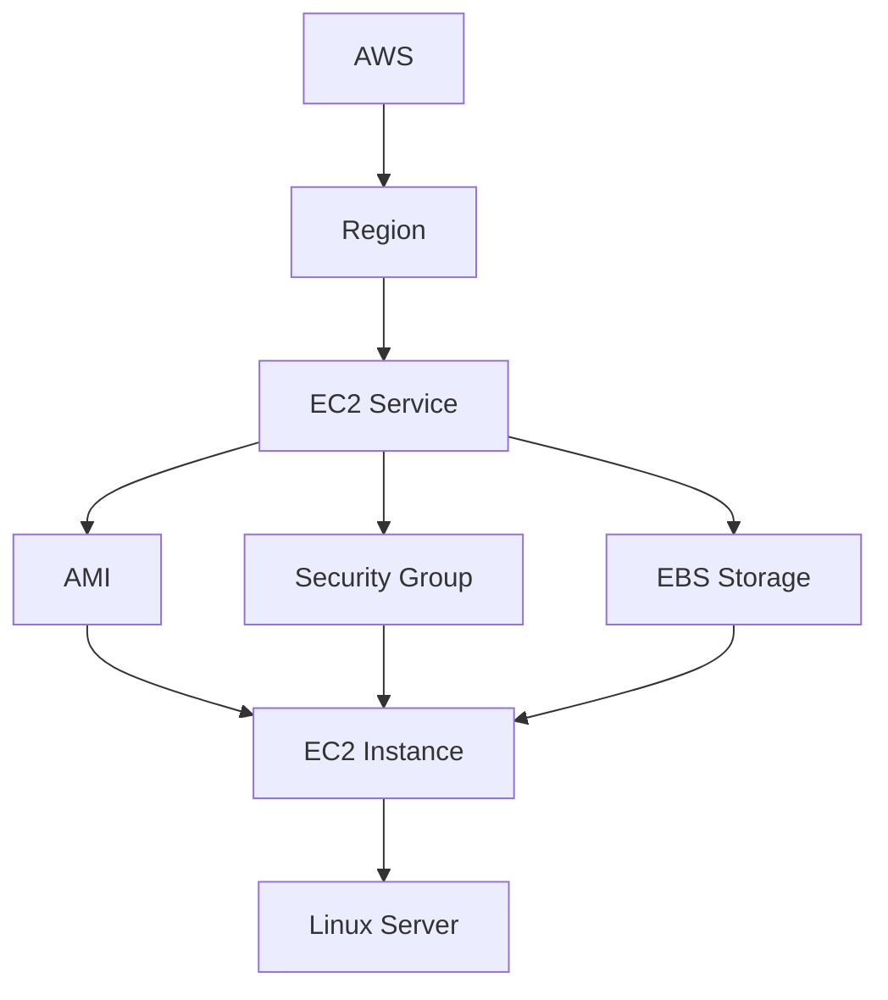

# EC2 Architecture

## Diagram

## Component Explanations

### AWS
The overall cloud platform. Amazon Web Services owns and operates every data center, network, and service involved here — it's the outermost container for everything below it.

### Region
A specific geographic location (e.g., `us-east-1`, `ap-south-1`) built from multiple isolated data centers. Every resource you create is tied to a region you choose, usually based on latency to your users, cost, or compliance needs.

### EC2 (Service)
The compute service that lives inside a region. Before you launch anything, EC2 is just the platform — the console, CLI, or API layer — you use to request and configure virtual servers.

### AMI
The Amazon Machine Image is the template EC2 boots a new instance from. It supplies the operating system and any pre-installed software, so the instance doesn't start from an empty disk.

### Security Group
The firewall rules attached at launch time, controlling what traffic can reach the instance and what it's allowed to send out. It's configured alongside the instance, not bolted on afterward.

### EBS Storage
The persistent disk volume(s) attached to the instance. It holds the OS and data and — unlike the instance's temporary state — survives stops and reboots.

### EC2 Instance
The actual running virtual machine, created once the AMI, Security Group, and EBS storage are combined. This is the real, billable resource with its own instance ID and IP address.

### Linux Server
What you actually work with once the instance boots — a live Linux operating system, supplied by the AMI, that you connect to and use like any other server.

---
*How to read the flow: AWS → Region → EC2 (the service) provisions an instance using three building blocks — AMI, Security Group, and EBS Storage — which combine into a running EC2 Instance, here booted with a Linux Server.*
