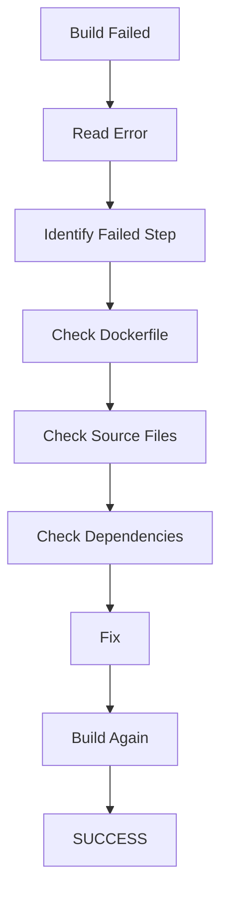

# Docker Build Troubleshooting — Training Exercise

**Duration:** 45 minutes
**Objective:** Practice a systematic approach to diagnosing and fixing a failed Docker build — from reading the error to verifying the fix actually works, not just that the build finishes.

## Troubleshooting Workflow



## How to Work Each Step

1. **Read Error** — Rebuild with full output: `docker build --progress=plain --no-cache .`. Read the *entire* final error block, not just the last line — Docker reports which numbered step and which instruction (`RUN`, `COPY`, etc.) failed.
2. **Identify Failed Step** — Match the step number in the error to the exact line in the Dockerfile. This tells you whether the failure is an OS/package problem, a build-context problem, or an application-level problem.
3. **Check Dockerfile** — Review the failing instruction and everything before it: base image, `WORKDIR`, copy order, build args, and flags (`--production`, `--no-cache-dir`, `--legacy-peer-deps`, etc.).
4. **Check Source Files** — Confirm the files that instruction needs actually exist in the build context and aren't silently excluded by `.dockerignore`.
5. **Check Dependencies** — Confirm the manifest (`package.json`, `requirements.txt`, `go.mod`, etc.) actually declares what the failing step needs, and that lockfiles are in sync with it.
6. **Fix** — Make the smallest change that addresses the root cause, not just the symptom on screen.
7. **Build Again** — Rebuild with `--no-cache` at least once, so the fix is proven and not just hiding behind a stale cached layer.
8. **SUCCESS** — Confirm the image builds *and* the container actually runs correctly. A successful build is not the same as a working application.

---

## Worked Example

### Problem:
Building a Next.js frontend image fails on the `RUN npm run build` step with `Cannot find module 'typescript'`, even though `typescript` is listed in `package.json`.

```text
 => ERROR [5/6] RUN npm run build                                        2.1s
------
 > [5/6] RUN npm run build:
#8 0.412
#8 0.412 > frontend@1.0.0 build
#8 0.412 > next build
#8 0.412
#8 0.612 Error: Cannot find module 'typescript'
#8 0.612 Require stack:
#8 0.612 - /app/node_modules/next/dist/cli/next-build.js
------
Dockerfile:9
--------------------
   7 |     WORKDIR /app
   8 |     COPY package.json package-lock.json ./
   9 | >>> RUN npm install --production
  10 |     COPY . .
  11 |     RUN npm run build
--------------------
ERROR: failed to solve: process "/bin/sh -c npm run build" did not complete successfully: exit code 1
```

### Root Cause:
`typescript` is declared under `devDependencies` in `package.json`. The Dockerfile installs with `npm install --production`, which skips `devDependencies` entirely. `next build` needs TypeScript to compile the project (a `tsconfig.json` is present) even though TypeScript itself isn't needed at runtime — so the build step fails before the app is ever compiled.

### Investigation:
- **Read Error:** Failure is at step `[5/6]`, the `RUN npm run build` instruction — not at `npm install`, and not an OS-level error. It's a Node module-resolution error, so the problem lives in `node_modules`, not the base image.
- **Check Dockerfile:** Line 9 uses `npm install --production`, a flag that's risky whenever a build step runs later in the *same* stage.
- **Check Source Files:** `tsconfig.json` exists in the repo, confirming TypeScript is genuinely required to build — not a stray leftover file.
- **Check Dependencies:** `package.json` confirms `typescript` sits under `devDependencies`. The `--production` flag did exactly what it was told; the Dockerfile just asked for the wrong install at this stage.

### Fix:
Move to a multi-stage build: install *all* dependencies (including dev) in a `build` stage where `next build` runs, then copy only the compiled output into a lean production stage that installs production-only dependencies.

```dockerfile
# ---- build stage ----
FROM node:18-alpine AS build
WORKDIR /app
COPY package.json package-lock.json ./
RUN npm ci
COPY . .
RUN npm run build

# ---- production stage ----
FROM node:18-alpine AS production
WORKDIR /app
ENV NODE_ENV=production
COPY package.json package-lock.json ./
RUN npm ci --omit=dev
COPY --from=build /app/.next ./.next
COPY --from=build /app/public ./public
EXPOSE 3000
CMD ["npm", "start"]
```

### Verification:
1. `docker build --no-cache -t frontend:fixed .` — confirms the image builds cleanly with no cached layer masking the old failure.
2. `docker run --rm -p 3000:3000 frontend:fixed` — confirms the container starts and doesn't crash-loop.
3. `curl -I http://localhost:3000` — confirms the app actually serves a response (HTTP 200), not just that the build finished.
4. `docker images frontend:fixed` — sanity-check the final image size, to confirm dev-only dependencies didn't sneak into the production layer.

---

## Reusable Template

Copy this block for any future Docker build failure:

```markdown
### Problem:


### Root Cause:


### Investigation:


### Fix:


### Verification:
```
