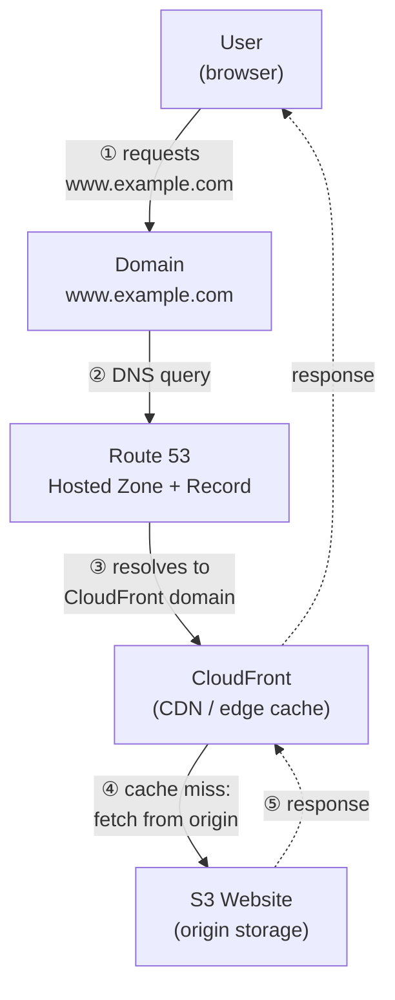

# Day 15 – Task 2: Route 53 Architecture

How a request for a static website travels from a user's browser, through Route 53 and CloudFront, down to S3 — and back.

---

## The Architecture

```
User (browser)
      │
      │  ① requests https://www.example.com
      ▼
www.example.com                      ← the Domain
      │
      │  ② DNS query: "where do I send this request?"
      ▼
Route 53 (DNS)                       ← the DNS service
  Hosted Zone: example.com
  Record: www  →  ALIAS  →  CloudFront distribution
      │
      │  ③ returns the CloudFront distribution's domain
      ▼
CloudFront                           ← the CDN
  Caches content at edge locations close to the user
      │
      │  ④ cache HIT  → serve the cached copy immediately
      │     cache MISS → pull from the origin below, then cache it
      ▼
S3 Website (Origin)                  ← the storage
  Holds the actual files: index.html, style.css, script.js, images...
      │
      ▼
Response flows back up: S3 → CloudFront → User's browser
```

**Visual version** (renders as a diagram on GitHub/GitLab):



---

## Request Flow, Step by Step

1. A user opens `https://www.example.com` in their browser.
2. The browser needs an IP address for that name, so it fires off a **DNS query**.
3. That query eventually reaches **Route 53**, which is the domain's authoritative DNS service. Route 53 looks in the **hosted zone** for `example.com`, finds the **record** for `www`, and sees it's an alias pointing at a CloudFront distribution.
4. The browser connects to the nearest **CloudFront** edge location. If that edge already has the page cached, it's served instantly. If not, CloudFront reaches back to its origin.
5. The origin is the **S3** bucket, which holds the actual website files. S3 returns the requested file to CloudFront, which caches it at the edge and hands it back to the user.
6. The browser renders the page. On the next visit (or for the next nearby user), CloudFront can likely serve it straight from cache — without touching S3 or Route 53 again until the cache expires.

---

## Component Breakdown

### 1. Domain
The domain — `www.example.com` here — is the human-readable name the user actually types or clicks. It's registered through a **domain registrar**, and its authoritative name servers must be pointed at Route 53 (automatic if Route 53 is also the registrar; otherwise the registrar's NS records are updated to Route 53's 4 assigned name servers). It's the entry point of the whole diagram — every layer below exists to answer "where does this name actually point?"

### 2. DNS
DNS is the resolution layer that turns the domain name into something the browser can connect to. In this architecture, **Route 53 is the DNS service** doing that translation: it receives the query for `www.example.com` and answers with the target configured in its records — no different in principle from Question 1 in `Day15_DNS_Theory.md`, just Route 53 specifically acting as the authoritative answer.

### 3. Hosted Zone
The Hosted Zone is the container inside Route 53 holding every DNS record for `example.com`. It's what makes Route 53 "aware" of this domain at all — without a hosted zone for `example.com`, there's nothing to answer queries with. This would be a **Public** Hosted Zone, since the site needs to be reachable by anyone on the internet (as opposed to a Private Hosted Zone, which only resolves inside a VPC).

### 4. Record
Inside that hosted zone sits the specific record for `www`. Best practice here is an **ALIAS record** (a Route 53–specific type) rather than a plain `CNAME`, pointing directly at the CloudFront distribution's domain name (something like `d123456abcdef8.cloudfront.net`). ALIAS is preferred because it's free to query and — unlike `CNAME` — can also be used at the zone apex (`example.com` with no `www`) if needed.

### 5. CloudFront
CloudFront is AWS's **CDN (Content Delivery Network)**. Once Route 53 resolves the domain, the request actually lands at the nearest CloudFront edge location rather than going straight to S3. CloudFront's job is to cache copies of the site close to users worldwide so repeat requests are served in milliseconds, while also terminating HTTPS (via a free AWS Certificate Manager certificate) and optionally integrating with AWS WAF for extra protection. This is the layer that makes the site both **fast** and **secure**.

### 6. S3
S3 (Simple Storage Service) is where the actual site files live — `index.html`, CSS, JS, images. CloudFront treats the S3 bucket as its **origin**: on a cache miss, it pulls the file from S3, caches it at the edge, and serves it. Current best practice is to keep the bucket **fully private** and reachable only by CloudFront, using **Origin Access Control (OAC)** — this stops anyone from bypassing CloudFront and hitting the S3 URL directly. (The older approach was Origin Access Identity, OAI — now legacy; the oldest approach, a fully public bucket with S3 "static website hosting" enabled, is no longer recommended for anything security-sensitive.)

---

## Why This Pattern?

This Route 53 → CloudFront → S3 setup is one of the most common AWS reference architectures for a static site or single-page app, because it's:

- **Fast** — content is served from an edge location near the user, not from S3's home region on every request
- **Cheap** — pay-per-use with no servers running 24/7; caching at the edge also cuts down on direct S3 data-transfer costs
- **Secure** — free HTTPS via ACM + CloudFront, and the S3 bucket can stay fully private behind OAC
- **Serverless & auto-scaling** — Route 53, CloudFront, and S3 all scale automatically; there's nothing to patch, provision, or manage at any layer

---

## Key Takeaways

- The request flows in one direction (**User → Domain → Route 53 → CloudFront → S3**) and the response flows back the same path in reverse.
- **Route 53** doesn't serve the website — it only answers "where is it?" by resolving the domain to CloudFront via a hosted zone and record.
- **CloudFront** sits in front of S3 as a caching, HTTPS-terminating layer — it's what users actually connect to.
- **S3** is just storage for the origin files; in a secure setup it's private and only CloudFront (via OAC) can reach it.
- Nothing in this stack is a traditional server — it's a fully managed, serverless path from DNS all the way to static file storage.
